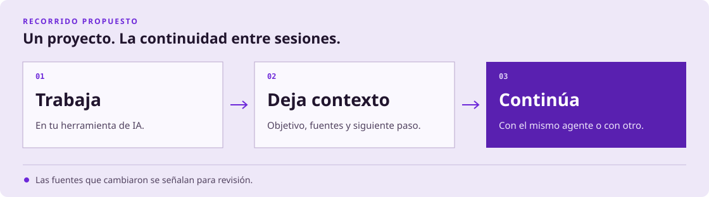

<p align="center">
  <picture>
    <source media="(prefers-color-scheme: dark)" srcset="assets/brand/logo-dark.svg">
    
  </picture>
</p>

<h2 align="center">Tu proyecto continúa.<br>Aunque cambies de agente.</h2>

<p align="center"><a href="README.md">English</a> · <b>Español</b></p>

<p align="center">
  <a href="docs/candidates/CONTINUITY-PILOT.md"></a>
  <a href="docs/versions/v0.2.md"></a>
  <a href="LICENSE"></a>
</p>

---

Deberías poder dejar una tarea, volver después o cambiar de herramienta de IA sin tener
que explicar otra vez todo tu proyecto.

**Umbral está evolucionando hacia una herramienta local de continuidad para proyectos
desarrollados con IA.** Su objetivo es llevar entre sesiones el objetivo, las decisiones,
la evidencia y el siguiente paso, haciendo visibles las fuentes que cambiaron antes de
que un agente se apoye en ellas.

> **Nueva etapa en `next`.** Esta dirección está aceptada en
> [UD-039](docs/decisions/DECISIONS.md). El diseño detallado está en revisión.
> Las herramientas de continuidad y la integración MCP todavía no están implementadas.

## Trabaja. Deja contexto. Continúa.

<p align="center">
  
</p>

La experiencia buscada es sencilla: conectas una vez, trabajas en tu herramienta habitual
y después pides continuar. Umbral debería entregar el contexto relevante y señalar las
fuentes registradas que necesitan revisión. Que una fuente cambie significa **revísala**;
no demuestra por sí mismo que la conclusión anterior sea falsa.

## Un producto, tres piezas

| Pieza | Función | Estado |
|---|---|---|
| Programa local | Conservar la continuidad y contrastar las fuentes registradas con los archivos actuales | Diseño en revisión |
| Acceso MCP | Permitir que los agentes guarden y recuperen ese estado mediante el mismo núcleo | Planeado |
| Integración con un agente | Incorporar la recuperación y el registro de avances al flujo de un cliente real | Planeada; hay que demostrar la invocación automática |

Git aporta el historial y las revisiones del repositorio. La función propuesta de Umbral
es relacionarlos con la tarea que continúa el agente. No prueba que una IA comprendió un
archivo ni puede comprobar dependencias que nunca quedaron registradas.

## Lo que funciona hoy

El **instrumento de observación v0.2** registra una carpeta, calcula huellas del contenido,
informa de cambios y distingue lecturas nuevas de evidencia reutilizada. Se conservan su
[guía](umbral/README.md), su [contrato de salida](umbral/CONTRACT.md) y la
[evidencia de la versión](docs/versions/v0.2.md).

Para colaboradores que quieran probar el instrumento existente desde esta copia:

```sh
cargo run --locked -p umbral -- init /ruta/al/proyecto
cargo run --locked -p umbral -- observe /ruta/al/proyecto
# Trabaja en el proyecto y vuelve a observarlo.
cargo run --locked -p umbral -- observe /ruta/al/proyecto
cargo run --locked -p umbral -- changes /ruta/al/proyecto
```

Esto es el observador, no la experiencia de continuidad propuesta. Los criterios de
lectura humana independiente de las versiones anteriores siguen pendientes.

## La primera versión útil

Construir primero el núcleo local, exponerlo por MCP y comprobar una integración real.
Usar el desarrollo de Umbral como primer caso, comparándolo contra Git y un buen archivo
de continuidad. Medir corrección, esfuerzo total, contexto e interrupciones innecesarias.

El [alcance del piloto](docs/candidates/CONTINUITY-PILOT.md) define los límites propuestos.
El código, los experimentos y la investigación existentes se conservan. Todavía no se
asigna un nuevo número de versión.

## Encuentra lo que necesitas

| Necesidad | Entrada |
|---|---|
| Dirección actual y siguiente trabajo | [Dirección del proyecto](docs/canonical/PROJECT-DIRECTION.md) |
| Nuevo piloto de continuidad | [Alcance y orden de construcción](docs/candidates/CONTINUITY-PILOT.md) |
| Herramienta existente | [Guía del observador](umbral/README.md) |
| Decisiones y evidencia | [Decisiones](docs/decisions/DECISIONS.md) · [Versiones](docs/versions/README.md) · [Experimentos](experiments/) |
| Colaborar o trabajar como agente | [Contribuir](CONTRIBUTING.md) · [AGENTS.md](AGENTS.md) |
| Explorar la investigación | [Documentación](docs/README.md) · [Índice de investigación](research/RESEARCH-INDEX.md) |
| Informar de una vulnerabilidad | [Seguridad](SECURITY.md) |

Local. Código abierto. Tus archivos siguen en tus herramientas; las decisiones aceptadas
siguen siendo tuyas. El logo es provisional.

[GPL-3.0-or-later](LICENSE) · [Decisión de licencia](docs/decisions/DECISIONS.md)
