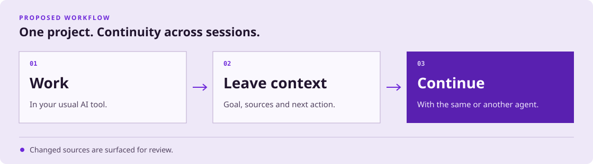

<p align="center">
  <picture>
    <source media="(prefers-color-scheme: dark)" srcset="assets/brand/logo-dark.svg">
    
  </picture>
</p>

<h2 align="center">Your project continues.<br>Even when your agent changes.</h2>

<p align="center"><b>English</b> · <a href="README.es.md">Español</a></p>

<p align="center">
  <a href="docs/candidates/CONTINUITY-PILOT.md"></a>
  <a href="docs/versions/v0.2.md"></a>
  <a href="LICENSE"></a>
</p>

---

You should be able to leave a task, return later, or switch AI tools without explaining
your whole project again.

**Umbral is becoming a local continuity tool for AI-assisted projects.** It is designed to
carry the goal, decisions, evidence and next action between sessions, while making changed
sources visible before an agent relies on them.

> **Building on `next`.** This is the new product direction, accepted in
> [UD-039](docs/decisions/DECISIONS.md). The detailed design is under review.
> The continuity tools and MCP integration are not implemented yet.

## Work. Leave context. Continue.

<p align="center">
  
</p>

The intended experience is simple: connect once, work in your usual AI tool, then ask it
to continue. Umbral should supply the relevant task context and identify recorded sources
that need checking. A changed source means **review it**, not that the earlier conclusion
is automatically false.

## One product, three parts

| Part | Job | Status |
|---|---|---|
| Local program | Keep task continuity and check recorded sources against the working copy | Design under review |
| MCP access | Let agents save and retrieve that state through the same core | Planned |
| Agent integration | Make retrieval and progress capture part of a real client's workflow | Planned; automatic invocation must be demonstrated |

Git provides repository history and revisions. Umbral's proposed role is to connect that
history to the work an agent is continuing. It will not prove that an agent understood a
file, and it cannot check dependencies that were never recorded.

## What works today

The existing **v0.2 observation instrument** records a folder, fingerprints file content,
reports changes and distinguishes fresh readings from reused evidence. Its
[tool guide](umbral/README.md), [output contract](umbral/CONTRACT.md) and
[version evidence](docs/versions/v0.2.md) are preserved.

For contributors who want to try the existing instrument from this checkout:

```sh
cargo run --locked -p umbral -- init /path/to/project
cargo run --locked -p umbral -- observe /path/to/project
# Work in the project, then observe it again.
cargo run --locked -p umbral -- observe /path/to/project
cargo run --locked -p umbral -- changes /path/to/project
```

This is the observer, not the proposed continuity experience. The independent-human
reader criteria of earlier versions remain open.

## The first useful version

Build the local core first, expose it through MCP, then verify one agent integration.
Use Umbral's own development as the first case, comparing against Git plus a good handoff
file. Measure correctness, total effort, context size and unnecessary interruptions.

The [pilot scope](docs/candidates/CONTINUITY-PILOT.md) defines the proposed boundaries.
Existing code, experiments and research stay in place. No new version number is assigned.

## Find your way

| Need | Go to |
|---|---|
| Current direction and next work | [Project direction](docs/canonical/PROJECT-DIRECTION.md) |
| New continuity pilot | [Scope and build order](docs/candidates/CONTINUITY-PILOT.md) |
| Existing tool | [Observer guide](umbral/README.md) |
| Decisions and evidence | [Decisions](docs/decisions/DECISIONS.md) · [Versions](docs/versions/README.md) · [Experiments](experiments/) |
| Contribute or work as an agent | [Contributing](CONTRIBUTING.md) · [AGENTS.md](AGENTS.md) |
| Explore the research | [Documentation](docs/README.md) · [Research index](research/RESEARCH-INDEX.md) |
| Report a vulnerability | [Security](SECURITY.md) |

Local-first. Open source. Your files stay in your tools; accepted decisions remain yours.
The logo is provisional.

[GPL-3.0-or-later](LICENSE) · [Licence decision](docs/decisions/DECISIONS.md)
